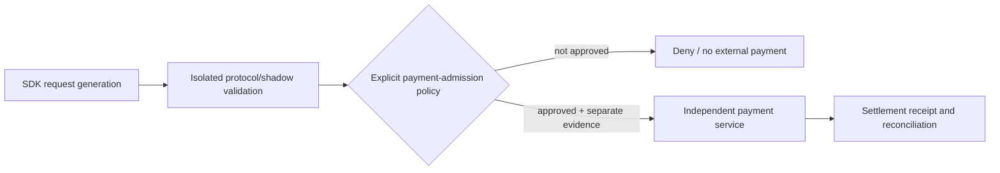

# Fork qualification notes — Machine Payments Protocol SDK

**Scope:** public TypeScript SDK fork of `mppx`. Integration is research/shadow-test scoped; **no live spending or payment-authority delegation** is granted by this document.

Research considers Machine Payments Protocol/x402-compatible interface behavior, auth, request/response normalization, replay protection, timeouts, error classification, bounded test fixtures and future integration points. A successful protocol test establishes neither commercial authorization nor payment settlement.

Keep private credentials, wallets, KYC material, billing artifacts and user data out of the repository. Preserve the upstream MIT license and notice. Production use requires separate explicit financial authority, provider terms, independently authenticated account state, budget and audited effect verification. A source merge or a mock HTTP response is **not** a paid transaction.
